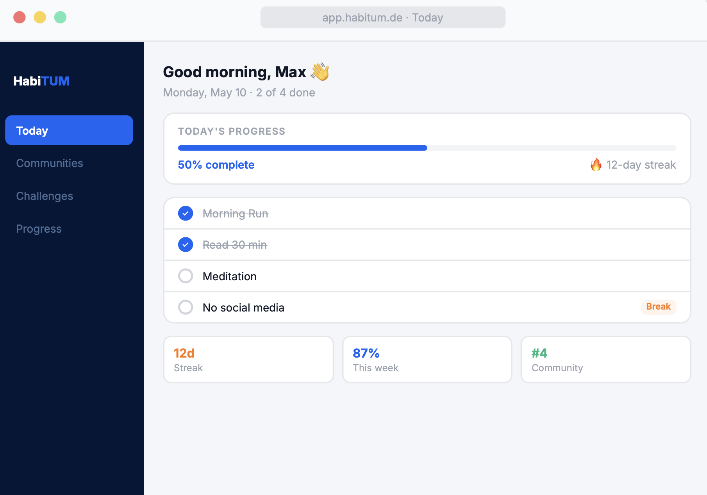
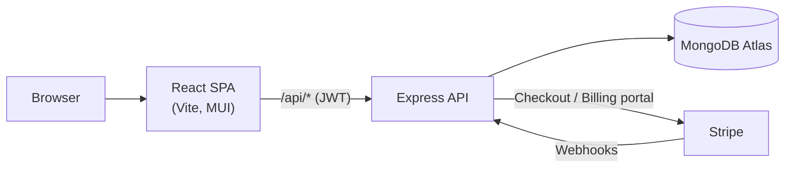

# HabiTUM

[](https://github.com/MaxPax0815/habitum/actions/workflows/ci.yml)

HabiTUM is a full-stack habit tracker with a social layer. Users build good habits or break bad ones with daily or weekly check-ins and streaks, join communities, and compete in time-boxed challenges with leaderboards and a community activity feed. Organisations such as student groups or companies can run their own communities through a paid manager plan.

Built by a team of four as the course project for *Software Engineering for Business Applications* (SEBA Master) at the Technical University of Munich, summer semester 2026.

<p align="center">
  
  <br><sub>Design mockup of the “Today” view</sub>
</p>

## Features

- **Habit tracking**: build/break habits, daily or weekly periods, one-tap check-in and undo, automatic streak tracking and streak resets
- **Progress analytics**: completion rates, best streaks and momentum over time (charts with Recharts)
- **Communities**: public or invite-only communities with member roles (member, admin, creator), invite links and community posts
- **Challenges**: time-boxed shared habits inside a community, with a leaderboard per challenge
- **Activity feed**: challenge check-ins appear in the community feed; undo revokes the post, so toggling can never spam the feed
- **Subscriptions via Stripe**: free, premium and manager plans, Stripe Checkout, billing portal and webhook-based subscription sync
- **Manager dashboard**: overview, community statistics and challenge adherence for organisations

## Tech stack

| Layer | Technologies |
|---|---|
| Frontend | React 19, Vite, Material UI, React Router, Recharts, Vitest |
| Backend | Node.js, Express 5, Mongoose (MongoDB Atlas), JWT auth, bcrypt, Stripe |
| Testing | Node test runner with in-memory MongoDB (`mongodb-memory-server`), Vitest |
| Tooling | Docker Compose, Stripe CLI (local webhooks), ESLint, GitHub Actions |

## Architecture



The API is organised by resource (habits, check-ins, communities, challenges, activities, billing, manager), each with its own model, controller and router. Permissions are enforced server-side along three axes: authentication, subscription tier and community membership/role. A detailed map of routes, data model and design decisions is in [`Backend/ARCHITECTURE.md`](Backend/ARCHITECTURE.md); the frontend structure is described in [`Frontend/README.md`](Frontend/README.md).

## Quick start (Docker)

Requirements: Docker, a MongoDB database (e.g. a free Atlas cluster) and a Stripe account in test mode.

```bash
git clone https://github.com/MaxPax0815/habitum.git
cd habitum
cp Backend/.env.example Backend/.env   # fill in MONGODB_URI, JWT_SECRET and the Stripe test keys
docker compose up --build
```

- Frontend: http://localhost:3000
- API: http://localhost:4000

> **Note:** the backend container seeds demo data on every start and **wipes the configured database first**. Only point `MONGODB_URI` at a development database.

After seeding, you can log in with these demo accounts (password `Test1234`):

| Account | Plan |
|---|---|
| `free@test.com` | Free |
| `premium@test.com` | Premium |
| `manager@test.com` | Manager |

## Running without Docker

```bash
# Terminal 1 – API on :4000
cd Backend
cp .env.example .env    # fill in the values
npm ci
npm run dev:fresh       # seed demo data, then start with nodemon

# Terminal 2 – frontend on :3000 (proxies /api to :4000)
cd Frontend
npm ci
npm run dev
```

## Tests

```bash
cd Backend && npm test    # unit + integration tests (in-memory MongoDB)
cd Frontend && npm test   # Vitest
```

## Project structure

```
habitum/
├── Backend/            Express API (see ARCHITECTURE.md)
├── Frontend/           React SPA (see README.md)
├── docker-compose.yml  Starts backend, frontend and the Stripe CLI webhook forwarder
└── .github/workflows/  CI: backend tests, frontend tests and build
```

## Team

| Name | GitHub |
|---|---|
| Maximilian Heidelbach | [@MaxPax0815](https://github.com/MaxPax0815) |
| Carlos Garzon Rodriguez | |
| Maximilian Michel | |
| nicksalfeld | |

My own focus in the project: the app shell and navigation (layout, sidebar, header), the landing page, login and signup, the profile and billing pages, and consolidating the two original course repositories into this monorepo.
